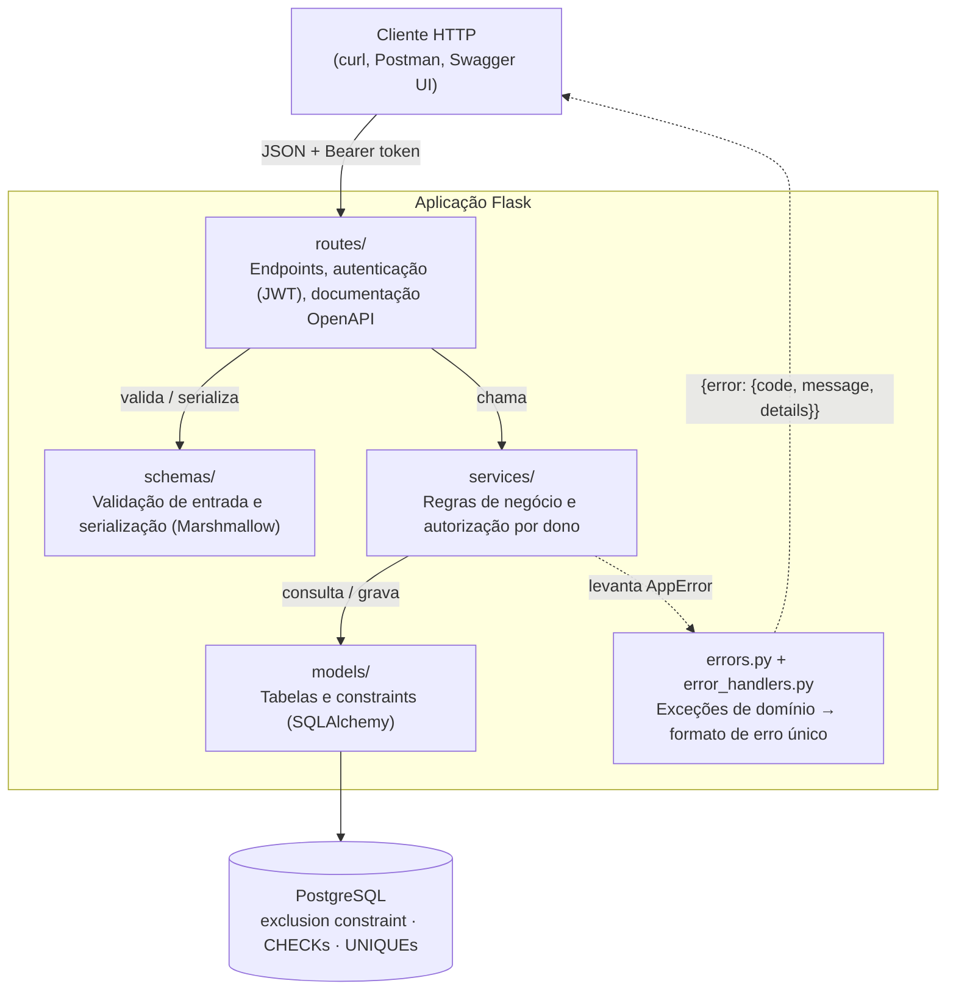
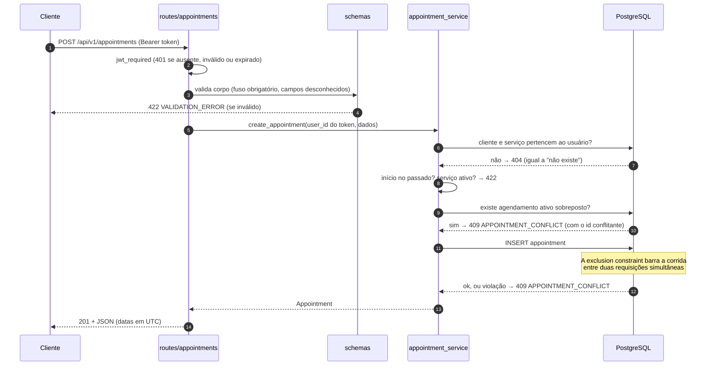
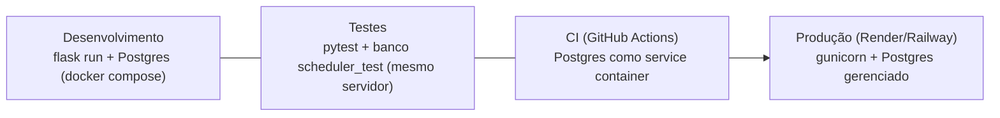

# Arquitetura

## Camadas

A regra de ouro: **rotas não têm regra de negócio**, **services não conhecem HTTP**.
Cada camada só conversa com a de baixo.



| Camada | Responsabilidade | Não deve |
|---|---|---|
| `routes/` | Receber a requisição, exigir JWT, validar via schema, chamar o service, escolher o status HTTP | Conter `if` de regra de negócio ou falar com o banco |
| `schemas/` | Definir o contrato (campos, tipos, limites, exemplos do Swagger) | Consultar o banco |
| `services/` | Aplicar regras (conflito de horário, máquina de estados, dono do recurso) | Importar `request`/`response` do Flask |
| `models/` | Mapear tabelas e declarar constraints | Conter fluxo de negócio |
| `errors.py` | Exceções de domínio (`NotFoundError`, `ConflictError`…) | Conhecer HTTP além do status associado |

## Fluxo de uma requisição: criar agendamento



## Estrutura de pastas

```
app/
  __init__.py        create_app(): monta extensões, rotas, handlers e CLI
  config.py          Config por ambiente (segredos só via variáveis de ambiente)
  extensions.py      db, migrate, jwt, limiter, api (instanciados sem app)
  auth.py            helpers do usuário autenticado
  errors.py          exceções de domínio
  error_handlers.py  formato de erro padronizado (inclui falhas do JWT)
  cli.py             comando `flask seed`
  models/            User, Customer, Service, Appointment
  schemas/           contratos de entrada/saída e envelopes de paginação
  routes/            blueprints /api/v1/... e exemplos do Swagger
  services/          regras de negócio (auth, clientes, catálogo, agendamentos, seed)
migrations/          Alembic (inclui a exclusion constraint e btree_gist)
tests/               unitários (services) e integração (endpoints), banco de teste separado
docs/                este diretório
```

## Ambientes



Os testes usam **PostgreSQL de verdade**, em um banco separado do de desenvolvimento, porque as
garantias mais importantes (exclusion constraint, `timestamptz`) não existem em SQLite.
