# Diagrama do banco de dados (DER)

Modelo em PostgreSQL. Todas as tabelas de negócio pertencem a um `users` (o dono do negócio),
e toda consulta da API é filtrada por esse dono.

```mermaid
erDiagram
    USERS ||--o{ CUSTOMERS : "possui"
    USERS ||--o{ SERVICES : "oferece"
    USERS ||--o{ APPOINTMENTS : "gerencia"
    CUSTOMERS ||--o{ APPOINTMENTS : "agenda"
    SERVICES ||--o{ APPOINTMENTS : "é prestado em"

    USERS {
        int id PK
        string name
        string email UK "único, sempre em minúsculas"
        string password_hash "argon2"
        timestamptz created_at
        timestamptz updated_at
    }

    CUSTOMERS {
        int id PK
        int user_id FK "ON DELETE CASCADE"
        string name
        string phone "opcional"
        string email "opcional; único por usuário"
        timestamptz created_at
        timestamptz updated_at
    }

    SERVICES {
        int id PK
        int user_id FK "ON DELETE CASCADE"
        string name
        int duration_minutes "CHECK > 0"
        numeric price "Numeric(10,2), CHECK >= 0"
        boolean active "default true"
        timestamptz created_at
        timestamptz updated_at
    }

    APPOINTMENTS {
        int id PK
        int user_id FK "denormalizado de propósito"
        int customer_id FK "ON DELETE RESTRICT"
        int service_id FK "ON DELETE RESTRICT"
        timestamptz start_at "UTC"
        timestamptz end_at "start_at + duração do serviço"
        string status "scheduled | completed | canceled"
        text notes "opcional"
        timestamptz created_at
        timestamptz updated_at
    }
```



## Constraints que carregam regra de negócio

| Constraint | Tabela | O que garante |
|---|---|---|
| `ex_appointments_no_overlap` | `appointments` | Um usuário não tem dois agendamentos **ativos** com horários sobrepostos. |
| `uq_customers_user_email` | `customers` | E-mail de cliente é único dentro do mesmo usuário (vários `NULL` são permitidos). |
| `ck_appointments_end_after_start` | `appointments` | O término é sempre posterior ao início. |
| `ck_appointments_status` | `appointments` | Só aceita `scheduled`, `completed` ou `canceled`. |
| `ck_services_duration_positive` | `services` | Duração maior que zero. |
| `ck_services_price_non_negative` | `services` | Preço não negativo. |

A regra de sobreposição é uma *exclusion constraint* (veja [decisões técnicas](technical-decisions.md#1-sobreposição-de-horários-service--constraint-do-banco)):

```sql
EXCLUDE USING gist (
    user_id WITH =,
    tstzrange(start_at, end_at) WITH &&
) WHERE (status = 'scheduled')
```

- O intervalo é semiaberto `[início, fim)`: terminar às 10:00 e começar outro às 10:00 não conflita.
- Só `scheduled` ocupa a agenda; cancelados e concluídos não bloqueiam horários.
- Exige a extensão `btree_gist`, criada na primeira migration.

## Integridade referencial

- Apagar um **usuário** apaga em cascata seus clientes, serviços e agendamentos.
- Apagar um **cliente** ou **serviço** que tenha agendamentos é bloqueado (`RESTRICT`): a API devolve
  `409` com uma mensagem explicativa (para serviços, a saída é desativar com `active=false`).
